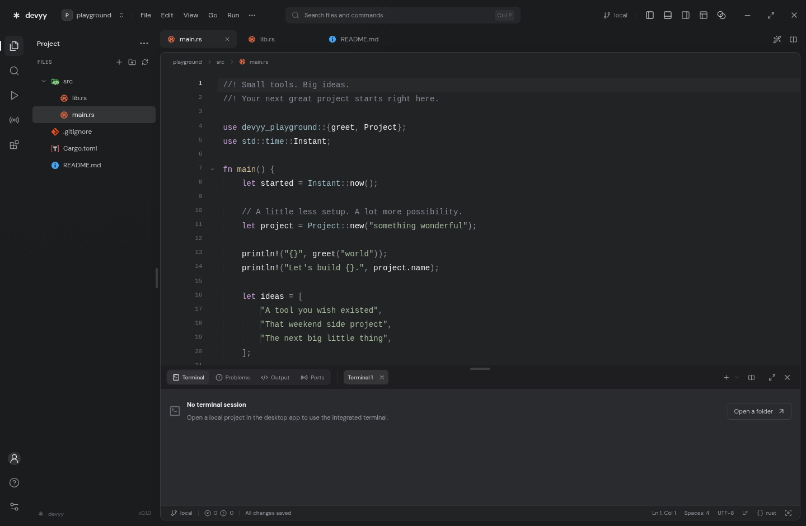

<p align="center"></p>

# Devyy

**A focused desktop workspace for writing, running, and shipping code.**

Open a folder and keep your editor, terminals, Git history, and AI tools within reach. Devyy runs on Windows, macOS, and Linux, and you can start with a local workspace as a guest.

[**Download Devyy**](https://github.com/trydevyy/devyy/releases/latest) · [Features](#what-you-can-do) · [Roadmap](ROADMAP.md) · [Contribute](CONTRIBUTING.md)

## Install Devyy

Open the [latest release](https://github.com/trydevyy/devyy/releases/latest), expand **Assets**, and download the file for your system.

| Platform                               | Download                                      | Install                                                                                                        |
| -------------------------------------- | --------------------------------------------- | -------------------------------------------------------------------------------------------------------------- |
| Windows x86, x64 or ARM64              | `Devyy-Setup-<version>-windows-<arch>.exe`    | Run Setup and choose your install location and shortcuts.                                                      |
| macOS Intel or Apple silicon           | `Devyy-Setup-<version>-macos-<arch>.dmg`      | Open the disk image and drag Devyy into **Applications**. Choose `x64` for Intel or `arm64` for Apple silicon. |
| Linux glibc x64 or ARM64, guided setup | `Devyy-Setup-<version>-linux-<arch>.AppImage` | Make Setup executable and follow the wizard.                                                                   |
| Linux glibc x64 or ARM64, portable     | `Devyy-<version>-linux-<arch>.AppImage`       | Make the AppImage executable and run it directly.                                                              |
| Debian or Ubuntu x64 or ARM64          | `Devyy-<version>-linux-<arch>.deb`            | Install the downloaded file with your package manager.                                                         |

The latest release link becomes available when the first stable release is published. [All releases](https://github.com/trydevyy/devyy/releases) also lists prereleases when available. Automated packages currently ship unsigned. Compare your download’s SHA-256 hash with the entry in `SHA256SUMS.txt` from the same release.

macOS downloads are added separately when available and have their own `SHA256SUMS-macos-<arch>.txt` file.

If macOS blocks the verified Devyy download on first launch, follow Apple’s [Open Anyway instructions](https://support.apple.com/en-us/102445).

**Linux guided setup** from your Downloads directory, using the actual downloaded filename:

```sh
chmod +x Devyy-Setup-0.1.0-linux-x64.AppImage
./Devyy-Setup-0.1.0-linux-x64.AppImage
```

On a system without FUSE, prefix the AppImage command with `APPIMAGE_EXTRACT_AND_RUN=1`. For Debian or Ubuntu, run `sudo apt install ./Devyy-0.1.0-linux-x64.deb` with the actual downloaded filename.

After installing, launch Devyy, choose **Continue as guest** or sign in, and select **Open a project**. Node.js is needed to run JavaScript extensions. Git and AI providers are set up separately when you use them.

## What you can do



| Feature                   | What you can do                                                                                                                         |
| ------------------------- | --------------------------------------------------------------------------------------------------------------------------------------- |
| **Edit and navigate**     | Split editors, jump to files and symbols, search across a workspace, format code, and use live Markdown and image previews.             |
| **Run and debug**         | Open independent terminal sessions and shell profiles, set breakpoints, and inspect stacks and variables with supported debug adapters. |
| **Review Git changes**    | Stage files, compare diffs, manage branches and submodules, and explore commit history in the graph.                                    |
| **Work remotely**         | Open SSH workspaces, use remote terminals, and manage forwarded ports from the workbench.                                               |
| **Extend your workspace** | Browse Open VSX or install VSIX files for themes, grammars, snippets, language tools, and supported extension views.                    |
| **Use AI on your terms**  | Configure a provider, attach selected editor or terminal context, and review proposed workspace edits. AI code completion is opt-in.    |
| **Make it yours**         | Change themes, accents, editor behavior, shortcuts, and layout. Review settings imports before applying them.                           |

Devyy implements a growing subset of the VS Code extension API. Extension support depends on each package and its platform requirements. See the [compatibility roadmap](ROADMAP.md) for the current feature boundaries.

### Crash reports

Builds configured for reporting let you preview and approve a diagnostic text file before it is sent to the Devyy team. Reports can include the app version, platform, failure category, source location, and extension ID. Native Rust panic reports appear on the next launch when a report was saved.

## Develop and contribute

```sh
git clone https://github.com/trydevyy/devyy.git
cd devyy
git submodule update --init docs
bun install --frozen-lockfile
bun run dev
```

The browser workspace requires Node.js 22 or later. Native development also requires access to the private HIT submodule. The [contributor guide](CONTRIBUTING.md) covers native setup, testing, packaging, and the release workflow. For installer development and removal, see the [installer guide](installer/README.md).

For end-to-end Store development, start the local API and web Store, then run a
debug desktop build with `DEVYY_LOCAL_STORE=1`. On macOS, build the `.app`
with `bun run tauri build --debug --bundles app` so Launch Services can register
`devyy://` URLs. Quit other Devyy instances, then launch the bundle with
`open --env DEVYY_LOCAL_STORE=1 src-tauri/target/debug/bundle/macos/Devyy.app`.
Add `--env DEVYY_LOCAL_ACCOUNT=1` to sign in to the local demo account and
test synchronization. Release builds always use the production services.

[Report a bug or suggest a feature](https://github.com/trydevyy/devyy/issues/new/choose) · [Report a security issue privately](SECURITY.md) · [Changelog](CHANGELOG.md)

Devyy is licensed under [GPL-3.0-only](LICENSE). The HIT submodule currently requires repository access for native source builds. **Settings → Credits & licenses** lists bundled dependency and asset notices.
